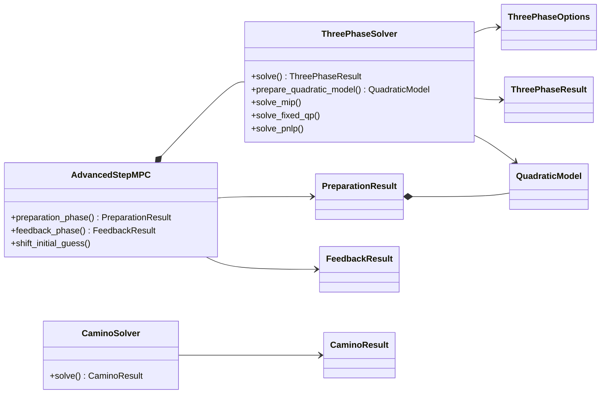

# Code structure

[Back to the README](../README.md) · [Options reference](../OPTIONS.md)

```text
src/mpc_implementation/
├── solver.py         Three-phase RNLP, integer reconstruction, and PNLP
├── mpc.py            Advanced-step preparation/feedback and trajectory shifting
├── options.py        Shared solver configuration
├── results.py        Result and quadratic-model data classes
└── camino_solver.py  Optional CAMINO adapter

examples/             Optimal control, MPC, and benchmark scripts
tests/                Unit and solver-path tests
```

Each example constructs a CasADi NLP, bounds, a discrete-variable mask, and trajectory index maps. It then calls `ThreePhaseSolver`, `AdvancedStepMPC`, or the optional `CaminoSolver` adapter.

- `ThreePhaseSolver` solves the relaxed NLP (RNLP), reconstructs the integer controls, and solves the polishing NLP (PNLP).
- `AdvancedStepMPC` separates preparation at a predicted state from feedback at the measured state and manages trajectory shifting.
- `ThreePhaseOptions` configures both solvers; see [OPTIONS.md](../OPTIONS.md).
- Result classes expose solutions, timings, and solver statistics.
- `CaminoSolver` provides an optional comparison with CAMINO.


